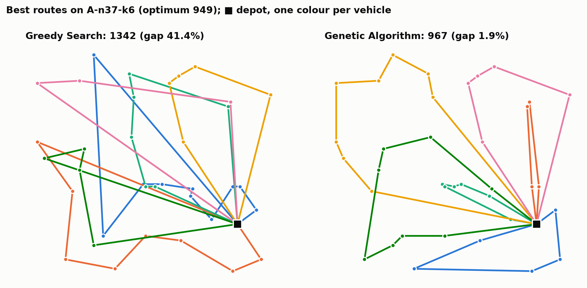
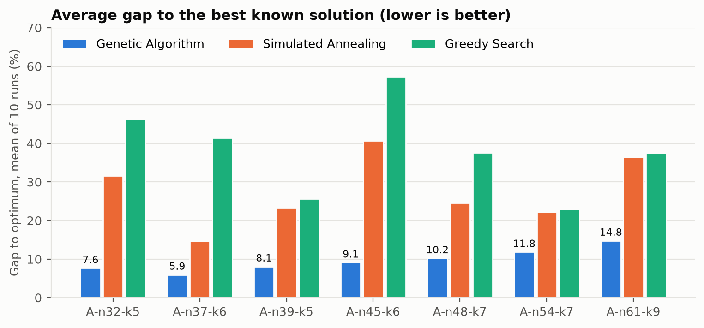
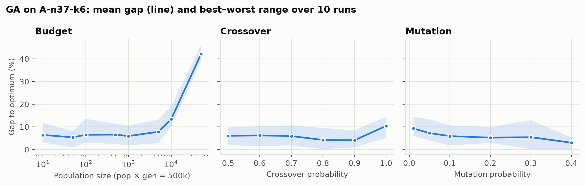

# CVRP Metaheuristics in Java


Four solvers for the **Capacitated Vehicle Routing Problem**, written from scratch in plain Java
with no dependencies and benchmarked on seven Augerat A-set instances against their known optima.

The genetic algorithm gets within **4.7% of the optimum on average** (best of 10 runs) and within
1.9% on two instances. It needs under a second per run.



## Problem

A depot and *n − 1* customers, each with a demand. Identical vehicles of capacity *Q* leave the
depot, serve customers and return. Every customer is visited exactly once, no route may exceed
*Q*, and the total Euclidean distance is minimised. Every solution returned by every solver is
checked for feasibility before it is scored (`Evaluator.isFeasible`).

## Solvers

| Solver | Representation | Search |
|---|---|---|
| **Random Search** | random permutation, split first-fit into routes | best of 1000 samples |
| **Greedy Search** | route by route | nearest feasible unvisited customer until the vehicle is full |
| **Simulated Annealing** | list of routes, initialised by Random Search | swap two customers between routes when capacity allows; T 1000 → 0.01, ×0.995 per step, 100 moves per temperature |
| **Genetic Algorithm** | giant-tour permutation of customers, split into routes in order whenever capacity would be exceeded | tournament selection (k = 5), ordered crossover (OX), swap or inversion mutation, single-individual elitism |

## Results

10 independent runs per stochastic solver with seeds 42…51. GA uses population 1000 ×
500 generations, *p<sub>x</sub>* = 0.7, *p<sub>m</sub>* = 0.1. Gap = (distance − optimum) / optimum.

| Instance | Optimum | RS best | Greedy | SA best / avg | GA best / avg | GA gap best / avg |
|---|--:|--:|--:|--:|--:|--:|
| A-n32-k5 | 784 | 1705 | 1146 | 869 / 1032 | **817** / 844 | 4.2% / 7.6% |
| A-n37-k6 | 949 | 1785 | 1342 | 1030 / 1088 | **967** / 1005 | 1.9% / 5.9% |
| A-n39-k5 | 822 | 1764 | 1033 | 951 / 1014 | **838** / 888 | 1.9% / 8.1% |
| A-n45-k6 | 944 | 2150 | 1485 | 1223 / 1328 | **993** / 1030 | 5.2% / 9.1% |
| A-n48-k7 | 1073 | 2406 | 1477 | 1277 / 1336 | **1121** / 1182 | 4.5% / 10.2% |
| A-n54-k7 | 1167 | 2664 | 1434 | 1323 / 1425 | **1255** / 1305 | 7.6% / 11.8% |
| A-n61-k9 | 1034 | 2560 | 1421 | 1279 / 1410 | **1109** / 1187 | 7.2% / 14.8% |
| **Mean gap** | | 121% | 38% | 17% / 28% | **4.7% / 9.6%** | |



Random Search is left out of the chart because its gap (120–170%) would flatten the other bars.

**Runtime per run** on a Ryzen 5 5600X: greedy < 1 ms, SA 80–120 ms, GA 0.5–1.2 s. The gap
grows with instance size for every solver.

### Why SA falls behind GA

The SA neighbourhood only swaps customers *between* routes. It never reorders customers inside a
route and never moves one customer to another route. A swap is rejected whenever it would break
capacity, so on tight instances most proposed moves are thrown away. The GA operates on the
giant-tour permutation, where inversion acts like a 2-opt move and the route split adapts
automatically.

## GA parameter study

All runs are on A-n37-k6 with 10 seeds each, changing one parameter at a time from the defaults
above.



- **Budget split.** With pop × gen fixed at 500k evaluations, anything from 10 × 50 000 to
  5 000 × 100 performs about the same (5–8% mean gap). Huge populations evolved for few
  generations collapse: 10 000 × 50 gives a 13% mean gap and 50 000 × 10 gives 42%.
- **Crossover.** Results are flat between 0.5 and 0.9, with the best mean at 0.8–0.9. At
  *p<sub>x</sub>* = 1.0 every child is a recombination, which removes the copy-with-mutation
  path and costs about 5 percentage points.
- **Mutation.** Higher mutation helps steadily: 9.3% mean gap at 0.01 and 3.0% at 0.4. The
  operators are cheap local moves, so they act as built-in local search.

The main table keeps *p<sub>x</sub>* = 0.7, *p<sub>m</sub>* = 0.1 rather than the best values
from this study, so the GA is not tuned on one of its own test instances.

## Run it

Requires JDK 21+ and Maven. Run from the repo root.

```bash
mvn package
java -jar target/cvrp-optimization.jar                                 # all solvers, all instances
java -jar target/cvrp-optimization.jar --instance A-n45-k6 --algo ga --pop 500 --gen 1000 --pm 0.3
java -jar target/cvrp-optimization.jar --help
```

Each call appends one row per (solver, instance) to `results/summary.csv` and writes the best
routes to `results/routes/`. To reproduce everything above (~3.5 min) and rebuild the figures:

```bash
./scripts/run_experiments.sh
uv run scripts/plot_results.py     # Python + matplotlib, dependencies declared inline
```

## Project structure

```
instances/                      Augerat A-set instances (TSPLIB format, optimum in COMMENT)
src/main/java/com/om/
  Main.java, Options.java       CLI, seeded runs, feasibility check
  solvers/                      RandomSearch, GreedySearch, SimulatedAnnealing, GeneticAlgorithm/*
  utils/                        Parser, Instance (distance matrix), Evaluator, Route, ResultWriter
scripts/                        experiment runner and figure generation
results/summary.csv             every number in this README
docs/                           figures
```

## Notes

- The optima in the instance headers were computed with TSPLIB `EUC_2D` distances rounded to
  integers. This code uses exact Euclidean distances, so a gap of a few tenths of a percent sits
  within that rounding difference.
- Natural next steps: relocate and 2-opt moves for SA, a 2-opt local-search pass on GA
  offspring (a memetic GA), and the larger X-set instances from
  [CVRPLIB](http://vrp.galgos.inf.puc-rio.br/index.php/en/).

## License

[MIT](LICENSE.txt)
